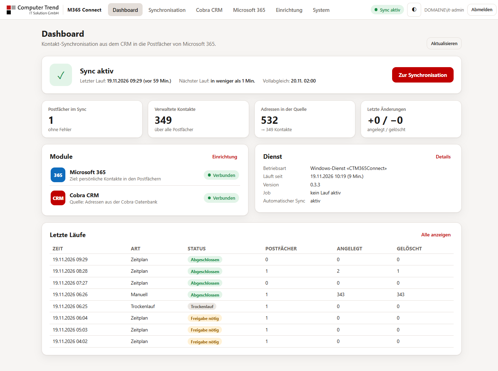
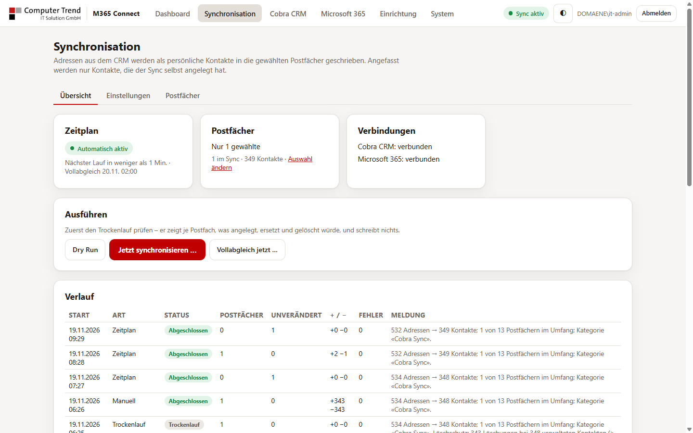
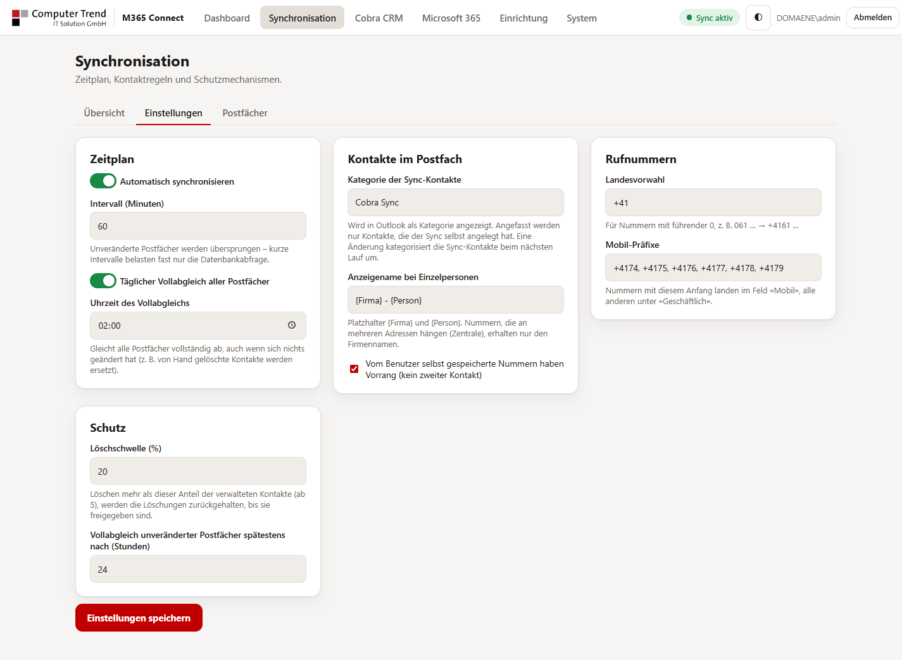
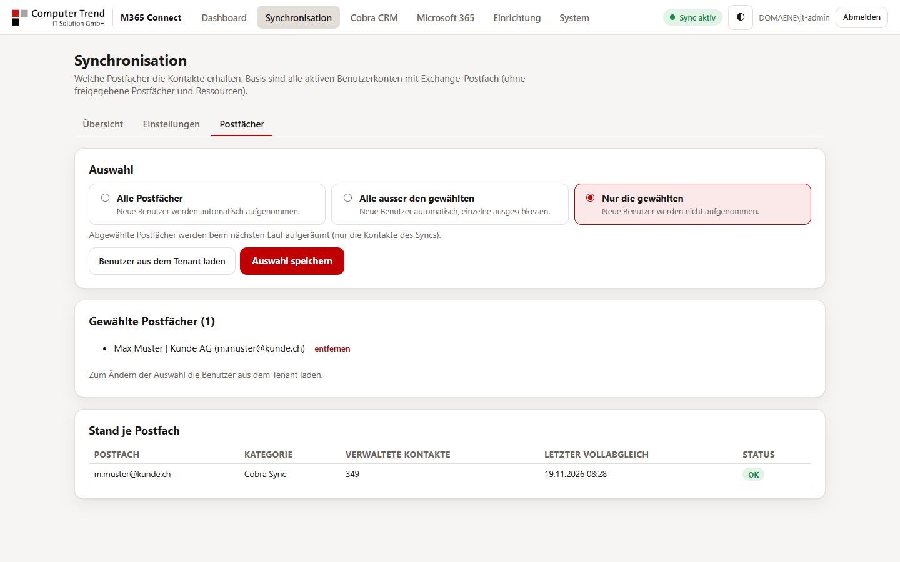
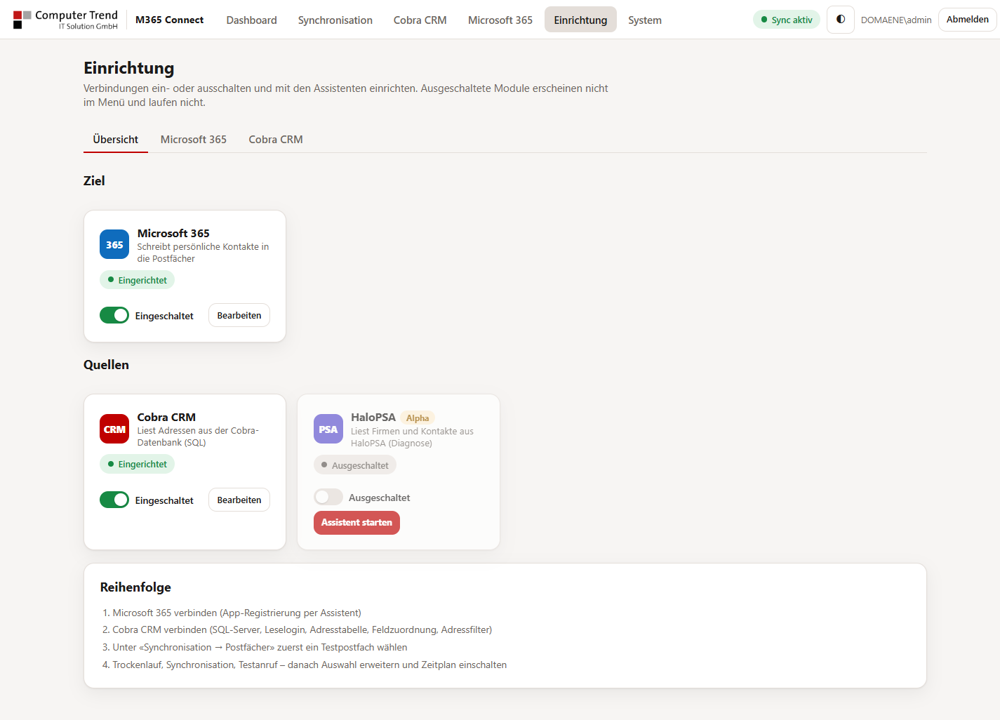
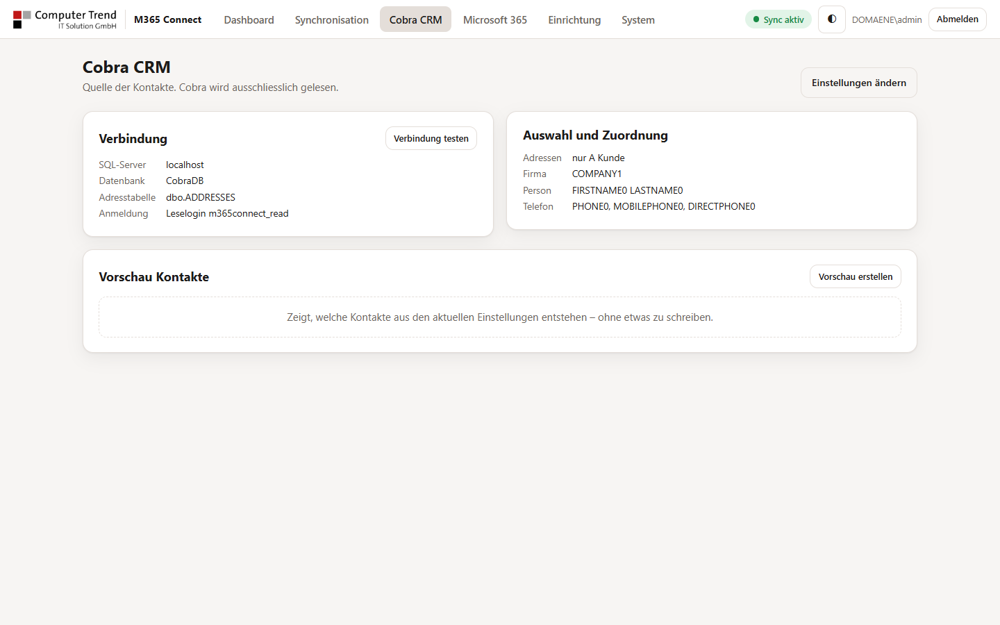
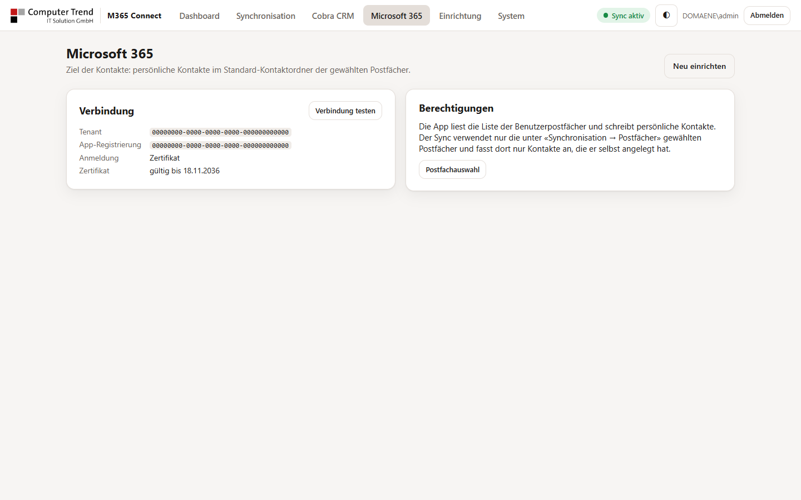
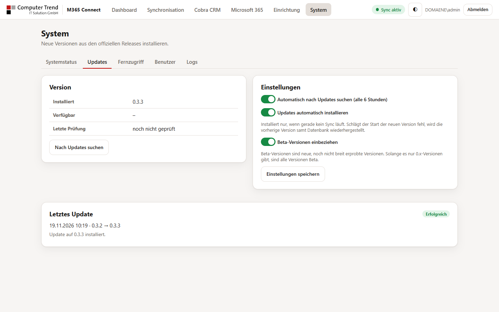
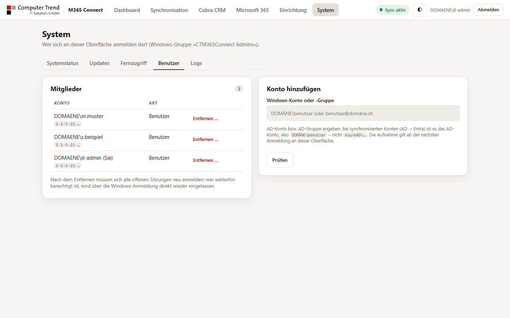

<div align="center">

# CT M365 Connect

**Kontakte aus dem CRM als Anruferkennung in Microsoft Teams**

[](https://github.com/c-trend/M365Connect-Public/releases)


</div>

<picture>
  <source media="(prefers-color-scheme: dark)" srcset="docs/images/00-dashboard-dark.png">
  
</picture>

CT M365 Connect liest Adressen aus dem CRM und legt sie als persönliche Kontakte in den gewählten Postfächern von
Microsoft 365 ab. Ruft eine Kundin oder ein Kunde an, zeigt Microsoft Teams sofort Firma und Namen statt nur der
Nummer. Das Programm läuft als Windows-Dienst beim Kunden und wird über eine Weboberfläche bedient.

> [!NOTE]
> Dieses Repository enthält nur die **signierten Release-Pakete** und die Anwenderdokumentation. Der Quellcode ist
> nicht öffentlich. CT M365 Connect wird von der Computer Trend IT-Solution GmbH für ihre Kundinnen und Kunden
> installiert und betreut.

## Funktionen

| | |
|---|---|
| **Anruferkennung in Teams** | Ein persönlicher Kontakt je Person bzw. Firmenzentrale im Standard-Kontaktordner – genau dort, wo Teams eingehende Nummern auflöst. |
| **CRM strikt lesend** | Cobra CRM wird über ein eigenes Leselogin mit Leserecht auf genau eine Tabelle gelesen. Im CRM wird nie etwas geändert. |
| **Nur eigene Kontakte** | Angefasst werden ausschliesslich Kontakte mit der eigenen Kategorie. Private Kontakte der Benutzer bleiben unberührt. |
| **Dry Run und Löschschutz** | Jeder Lauf lässt sich vorher ohne Schreiben prüfen. Grosse Löschmengen werden zurückgehalten, bis sie ausdrücklich freigegeben sind. |
| **Zeitplan** | Automatischer Abgleich im Intervall und ein täglicher Vollabgleich. Unveränderte Postfächer werden übersprungen. |
| **Postfachauswahl** | Alle Postfächer, alle ausser einzelnen oder nur gewählte – neue Benutzer auf Wunsch automatisch. |
| **Einrichtungsassistenten** | App-Registrierung in Entra ID mit Zertifikat und Cobra-Leselogin werden geführt eingerichtet. |
| **Updates mit Rückroll** | Signierte Updates direkt aus der Oberfläche. Startet eine neue Version nicht, wird die vorherige samt Datenbank wiederhergestellt. |
| **Überwachung** | Feste Ereignis-IDs im Anwendungsprotokoll für RMM-Werkzeuge, z. B. «Freigabe nötig» oder «Sync fehlgeschlagen». |
| **Windows-Anmeldung** | Zugang zur Oberfläche nur für Mitglieder einer Windows-Gruppe, gepflegt direkt in der Oberfläche. |

## Einblicke

<table>
  <tr>
    <td width="50%"><a href="docs/images/02-synchronisation.png"></a><br><sub><b>Synchronisation</b> – Zeitplan, Dry Run und Verlauf aller Läufe</sub></td>
    <td width="50%"><a href="docs/images/03-sync-einstellungen.png"></a><br><sub><b>Einstellungen</b> – Intervall, Kategorie, Anzeigename, Rufnummern, Löschschwelle</sub></td>
  </tr>
  <tr>
    <td><a href="docs/images/04-postfaecher.png"></a><br><sub><b>Postfächer</b> – Auswahl und Stand je Postfach</sub></td>
    <td><a href="docs/images/07-einrichtung.png"></a><br><sub><b>Einrichtung</b> – Module und Assistenten</sub></td>
  </tr>
  <tr>
    <td><a href="docs/images/05-cobra.png"></a><br><sub><b>Cobra CRM</b> – Verbindung, Adressauswahl und Feldzuordnung</sub></td>
    <td><a href="docs/images/06-microsoft365.png"></a><br><sub><b>Microsoft 365</b> – App-Registrierung mit Zertifikat</sub></td>
  </tr>
  <tr>
    <td><a href="docs/images/09-updates.png"></a><br><sub><b>Updates</b> – signierte Releases mit automatischem Rückroll</sub></td>
    <td><a href="docs/images/11-benutzer.png"></a><br><sub><b>Benutzer</b> – Zugang über die Windows-Gruppe</sub></td>
  </tr>
</table>

## Systemvoraussetzungen

| | |
|---|---|
| **Server** | Windows Server 2019 oder neuer (2016 wird unterstützt), Mitglied der Domäne empfohlen |
| **Runtime** | .NET und ASP.NET Core Runtime 10 – installiert das Setup-Skript bei Bedarf automatisch |
| **CRM** | Cobra CRM mit SQL-Server, vom Server aus erreichbar |
| **Microsoft 365** | Exchange Online; für die Einrichtung ein Konto mit «Globaler Administrator» oder «Administrator für privilegierte Rollen» |
| **Netz ausgehend** | HTTPS zu `login.microsoftonline.com`, `graph.microsoft.com` und GitHub (Updates) |

## Installation in Kürze

1. Das neueste Paket `M365Connect-<Version>-win-x64.zip` unter [Releases](https://github.com/c-trend/M365Connect-Public/releases) herunterladen und
   `Install-M365Connect.ps1` daraus entpacken.
2. In einer PowerShell **als Administrator** auf dem Server ausführen:

   ```powershell
   Set-ExecutionPolicy -Scope Process Bypass
   .\Install-M365Connect.ps1 -AdminMembers 'DOMÄNE\techniker'
   ```

   Das Skript lädt das neueste Release, prüft Prüfsumme und Signatur, installiert die Runtime falls nötig, richtet
   Gruppe, Ereignisquelle und Dienst ein und zeigt zum Schluss einen Einrichtungs-Token.
3. Auf dem Server `https://localhost:8443/` öffnen, den Token eingeben und den Assistenten folgen.

Die vollständige Anleitung mit allen Schritten steht in **[Installation und Einrichtung](docs/installation.md)**.

## Dokumentation

| Dokument | Inhalt |
|---|---|
| [Installation und Einrichtung](docs/installation.md) | Setup-Skript, Microsoft 365, Cobra CRM, erster Lauf, Zeitplan |
| [Betrieb](docs/betrieb.md) | Updates, Löschschutz, Benutzer, Fernzugriff, Logs, Deinstallation, Fehlerbehebung |
| [Überwachung](docs/ueberwachung.md) | Ereignis-IDs für RMM-Werkzeuge, Beispiel NinjaOne |
| [Sicherheit](docs/sicherheit.md) | Berechtigungen, Anmeldung, Schutz von Zugangsdaten, Update-Signatur |
| [Änderungen](CHANGELOG.md) | Neuerungen je Version |

## Paketinhalt und Prüfung

Jedes Release enthält drei Dateien:

| Datei | Zweck |
|---|---|
| `M365Connect-<Version>-win-x64.zip` | Programmpaket mit Dienst, Kommandozeile, Update-Programm und Setup-Skript |
| `…zip.sha256` | SHA256-Prüfsumme |
| `…zip.sig` | ECDSA-Signatur (P-256) über das Paket |

Setup-Skript und Update-Programm prüfen Prüfsumme **und** Signatur gegen den im Programm eingebauten öffentlichen
Schlüssel, bevor etwas installiert wird. Das Update-Programm installiert nie eine ältere Version über eine neuere.

## Support

Anfragen bitte über den gewohnten Support-Kanal von Computer Trend, nicht über GitHub-Issues.
Sicherheitsrelevante Hinweise: siehe [SECURITY.md](SECURITY.md).

## Lizenz

Proprietäre Software der Computer Trend IT-Solution GmbH, alle Rechte vorbehalten – siehe [LICENSE](LICENSE).
Die öffentliche Bereitstellung der Pakete dient nur der Verteilung von Updates an berechtigte Installationen.
Enthaltene Komponenten Dritter: [THIRD-PARTY-NOTICES.md](THIRD-PARTY-NOTICES.md).
