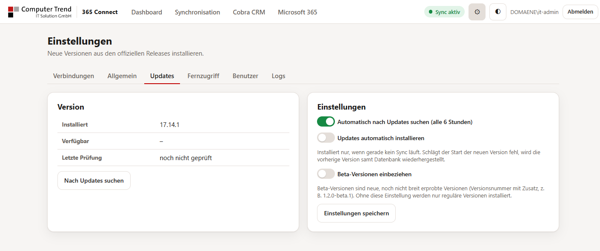
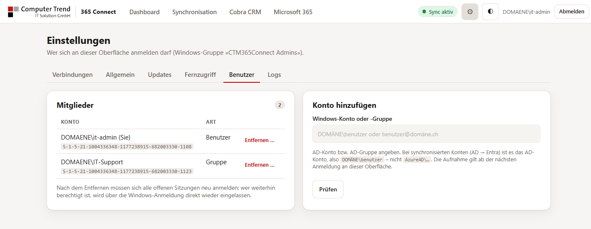
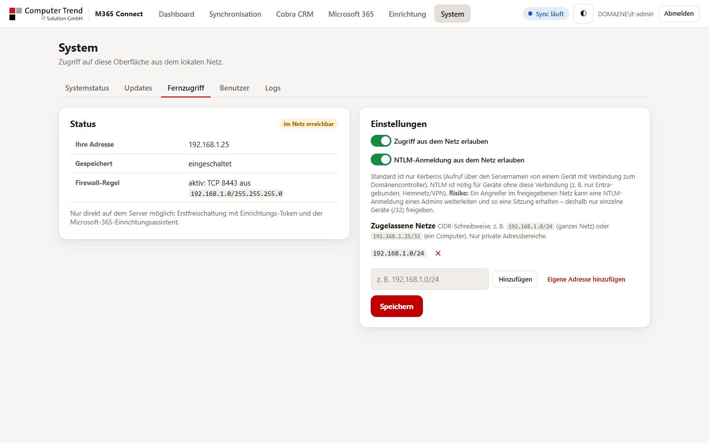

# Betrieb

**Inhalt**

- [Dashboard und Verlauf](#dashboard-und-verlauf)
- [Löschschutz: «Freigabe nötig»](#löschschutz-freigabe-nötig)
- [Updates](#updates)
- [Benutzer](#benutzer)
- [Fernzugriff](#fernzugriff)
- [Verzeichnisse und Logs](#verzeichnisse-und-logs)
- [Konfiguration](#konfiguration)
- [Rückbau und Deinstallation](#rückbau-und-deinstallation)
- [Fehlerbehebung](#fehlerbehebung)

---

## Dashboard und Verlauf

Das **Dashboard** zeigt auf einen Blick, ob der Sync läuft, wann der nächste Lauf ansteht, wie viele Postfächer und
Kontakte verwaltet werden und wie die letzten Läufe ausgegangen sind. Oben rechts steht der Gesamtzustand
(«Sync aktiv», «Freigabe nötig», «Letzter Sync fehlgeschlagen» …).

Unter **Synchronisation → Übersicht** stehen alle Läufe mit Meldung. **Synchronisation → Postfächer** zeigt den Stand
je Postfach.

## Löschschutz: «Freigabe nötig»

Würde ein Lauf mehr als den eingestellten Anteil der verwalteten Kontakte löschen oder ersetzen (Standard 20 %,
ab 5 Kontakten), hält das Programm alle Löschungen und Ersetzungen zurück. Neue Kontakte werden trotzdem angelegt.
Typische Ursachen sind ein geänderter Adressfilter, eine geänderte Feldzuordnung oder ein Problem in der Quelle.

1. **Synchronisation → Dry Run** ausführen und die Tabelle prüfen.
2. Ist der Plan richtig: **Genau diesen Plan freigeben**. Die Freigabe gilt nur für genau diesen Plan und
   24 Stunden; ändert sich der Plan, braucht es eine neue Freigabe.
3. Der nächste Lauf führt die Löschungen aus.

Ist der Plan falsch, die Ursache beheben (z. B. Einstellungen in Cobra CRM) und erneut einen Dry Run ausführen.

## Updates



**System → Updates** zeigt die installierte und die verfügbare Version.

- **Nach Updates suchen** fragt die Releases dieses Repositorys ab. Automatisch alle 6 Stunden, wenn eingeschaltet.
- **Jetzt installieren** lädt das Paket, prüft Prüfsumme und Signatur und übergibt an das Update-Programm. Die
  Oberfläche ist dabei etwa eine Minute nicht erreichbar.
- **Updates automatisch installieren** installiert nur, wenn gerade kein Sync läuft.
- **Beta-Versionen einbeziehen**: zusätzlich Versionen mit Zusatz (z. B. `1.2.0-beta.1`) anbieten. Standard aus.

Das Update-Programm sichert vor dem Tausch Programm und Datenbank. Startet die neue Version nicht innerhalb von drei
Minuten sauber, werden **Programm und Datenbank automatisch zurückgespielt**. Das Ergebnis erscheint unter
«Letztes Update»; Details stehen in `C:\ProgramData\CT M365 Connect\update\updater.log`.

## Benutzer



Anmelden darf sich nur, wer Mitglied der lokalen Windows-Gruppe **«CTM365Connect Admins»** ist – direkt oder über
eine AD-Gruppe. Unter **System → Benutzer** lassen sich Konten aufnehmen und entfernen:

- Eingabe als `DOMÄNE\benutzer`, `benutzer@domäne.ch` oder AD-Gruppe → **Prüfen** → **Hinzufügen**.
- Bei Konten, die aus dem AD nach Entra ID synchronisiert werden, ist das **AD-Konto** einzutragen, nicht `AzureAD\…`.
- Integrierte und breite Gruppen (Jeder, Domänen-Benutzer usw.) werden abgelehnt. Bei AD-Gruppen erhalten alle,
  auch verschachtelte Mitglieder Zugang – nur eng gefasste Gruppen verwenden.
- Das letzte Mitglied lässt sich nicht entfernen. Nach dem Entfernen müssen sich alle offenen Sitzungen neu anmelden.

Notfall, wenn niemand mehr hineinkommt: auf dem Server als lokaler Administrator

```powershell
net localgroup "CTM365Connect Admins" DOMÄNE\benutzer /add
```

## Fernzugriff



Standardmässig ist die Oberfläche nur direkt auf dem Server erreichbar (`https://localhost:8443/`). Unter
**System → Fernzugriff** lässt sie sich für freigegebene **private** Netze öffnen. Das Programm pflegt dazu
automatisch eine Windows-Firewall-Regel und prüft die Adresse jedes Besuchers zusätzlich selbst.

- Netze in CIDR-Schreibweise angeben, z. B. `192.168.1.0/24` (ganzes Netz) oder `192.168.1.25/32` (ein Gerät).
- Aufruf über den **Servernamen** (z. B. `https://server.kunde.local:8443/`) – unter **System → Systemstatus**
  steht die genaue Adresse.
- Aus dem Netz ist nur die **Kerberos**-Anmeldung zugelassen. Geräte ohne Verbindung zum Domänencontroller
  (z. B. nur in Entra ID eingebunden) brauchen den Schalter «NTLM-Anmeldung aus dem Netz erlauben»; dann nur
  einzelne Geräte (`/32`) freigeben.
- Passworteingaben (z. B. im Cobra-Assistenten) und die Einrichtung von Microsoft 365 bleiben direkt auf dem Server,
  solange ein selbstsigniertes Zertifikat verwendet wird.
- Das Ein- und Ausschalten wirkt nach einem Neustart des Dienstes; die Seite bietet ihn an.

## Verzeichnisse und Logs

| Pfad | Inhalt |
|---|---|
| `C:\Program Files\CT M365 Connect\` | Programm |
| `C:\ProgramData\CT M365 Connect\m365connect.db` | Datenbank (Einstellungen, Verlauf, Audit) |
| `C:\ProgramData\CT M365 Connect\secrets\` | verschlüsselte Zugangsdaten (Windows DPAPI) |
| `C:\ProgramData\CT M365 Connect\logs\` | Logdateien, 30 Tage |
| `C:\ProgramData\CT M365 Connect\update\` | Downloads, Sicherung vor dem letzten Update, `updater.log` |

Das Datenverzeichnis ist nur für SYSTEM und Administratoren zugänglich. Warnungen und Fehler stehen zusätzlich in der
Windows-Ereignisanzeige unter **Anwendung**, Quelle «CT M365 Connect» (siehe [Überwachung](ueberwachung.md)).
**System → Logs** zeigt die letzten Einträge in der Oberfläche.

> [!NOTE]
> Die Datenbank und die Zugangsdaten sind an den Server gebunden (DPAPI). Bei einem Serverwechsel das Programm auf
> dem neuen Server neu einrichten, nicht die Dateien kopieren.

## Konfiguration

Die Grundeinstellungen stehen in `appsettings.json` im Programmverzeichnis. Diese Datei wird bei jedem Update
ersetzt. Abweichende Werte deshalb in `appsettings.Production.json` daneben eintragen – nur die geänderten Einträge:

```json
{
  "M365Connect": {
    "WebPort": 8443,
    "SessionIdleMinutes": 30
  }
}
```

Nach einer Änderung den Dienst neu starten: `Restart-Service CTM365Connect`.

Eigenes Zertifikat statt des selbstsignierten: Zertifikat in `LocalMachine\My` installieren und den Fingerabdruck als
`"CertificateThumbprint"` eintragen.

## Rückbau und Deinstallation

1. **Synchronisation → Rückbau prüfen** → **Alle Sync-Kontakte entfernen …** – entfernt alle Kontakte, die das
   Programm angelegt hat, und schaltet den automatischen Sync aus. Private Kontakte bleiben unberührt.
2. Programm entfernen: `Install-M365Connect.ps1` aus `C:\Program Files\CT M365 Connect` an einen anderen Ort
   kopieren (das Skript entfernt den Programmordner) und dort in einer PowerShell als Administrator ausführen:

   ```powershell
   .\Install-M365Connect.ps1 -Uninstall -RemoveData
   ```

3. In Entra ID die App-Registrierung «CT M365 Connect - Sync» löschen.
4. Auf dem SQL-Server das Leselogin `m365connect_read` entfernen.
5. Bei Bedarf die Gruppe «CTM365Connect Admins» löschen: `net localgroup "CTM365Connect Admins" /delete`.

## Fehlerbehebung

| Meldung / Verhalten | Ursache und Lösung |
|---|---|
| «Kein Zugriff» beim Öffnen der Oberfläche | Konto ist nicht in «CTM365Connect Admins», oder die Mitgliedschaft ist noch nicht im Windows-Token. Konto aufnehmen und neu anmelden. |
| «Anmeldung nicht erlaubt» aus dem Netz | Gerät meldet sich per NTLM an. Über den Servernamen statt der IP aufrufen oder unter Fernzugriff NTLM für dieses Gerät erlauben. |
| Seite aus dem Netz nicht erreichbar | Fernzugriff aus oder Netz nicht freigegeben; nach dem Einschalten ist ein Dienst-Neustart nötig. |
| «Cobra-Anmeldung gesperrt» | Nach einem Anmeldefehler laufen keine automatischen Läufe mehr. Leselogin prüfen bzw. im Assistenten neu einrichten und speichern. |
| «Freigabe nötig» | Löschschutz hat angeschlagen – siehe [Löschschutz](#löschschutz-freigabe-nötig). |
| Postfach mit Status «Fehler» | Postfach nicht erreichbar (z. B. Lizenz entfernt). Meldung unter Synchronisation → Postfächer prüfen. |
| Teams zeigt keinen Namen | Zweimal anrufen (Zwischenspeicher von Teams). Prüfen, ob die Nummer im Kontakt mit Landesvorwahl gespeichert ist. |
| Update fehlgeschlagen | Die vorherige Version läuft wieder. Details in `update\updater.log`. |
| Zertifikat der App läuft ab (nach 10 Jahren) | Einrichtung → Microsoft 365 erneut ausführen und die alte App-Registrierung löschen. |
