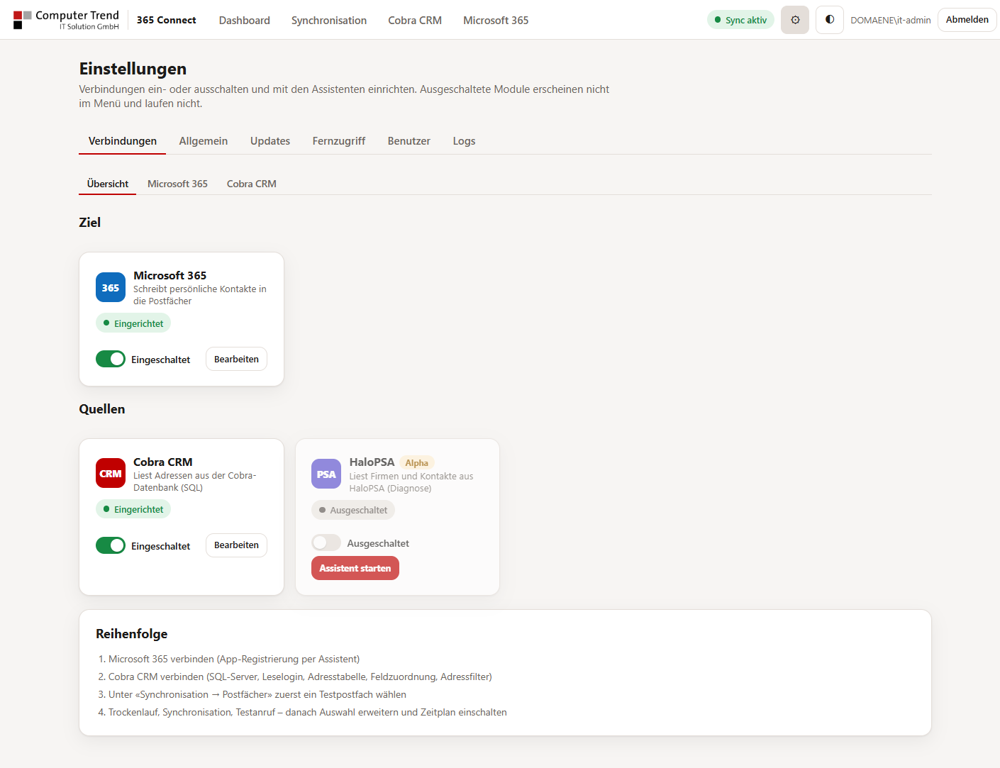
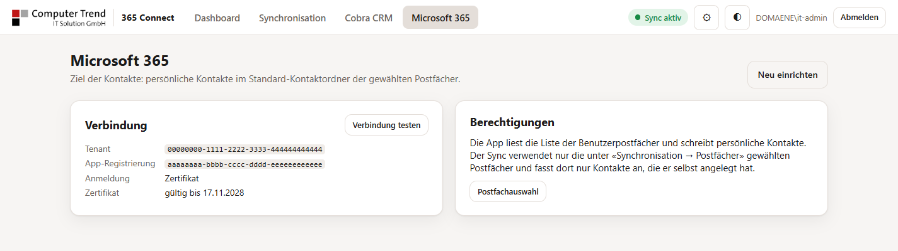
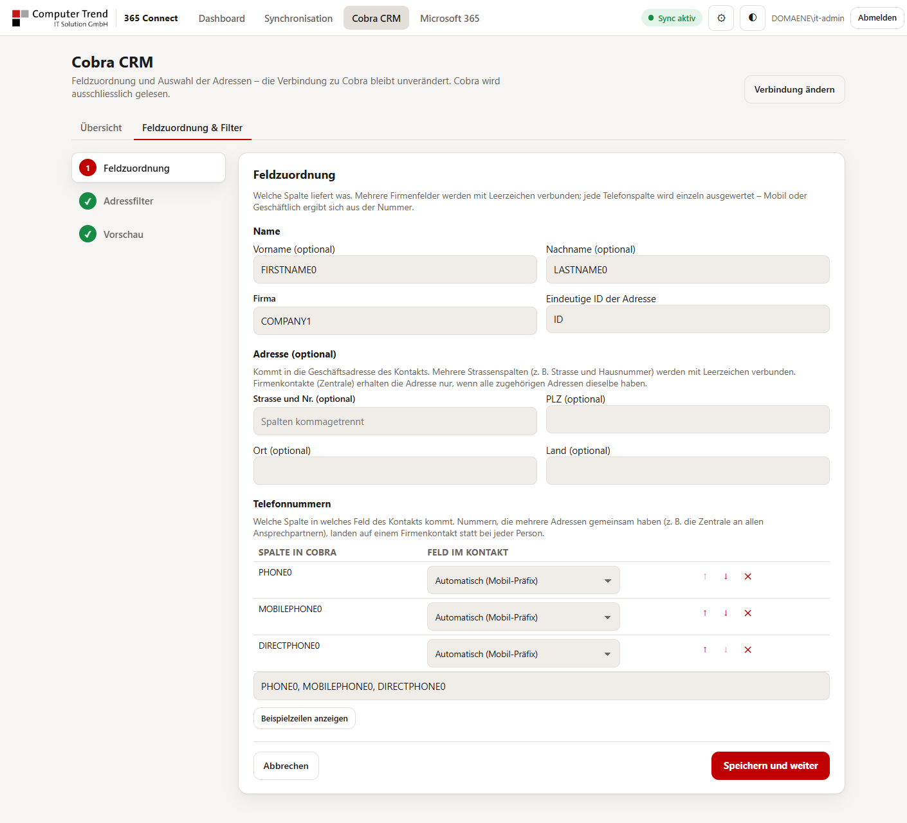
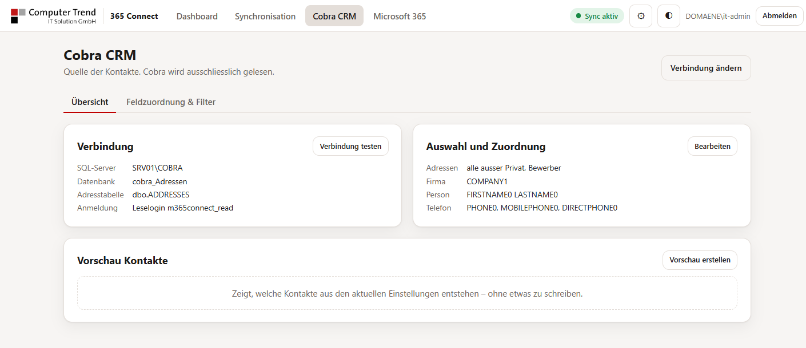
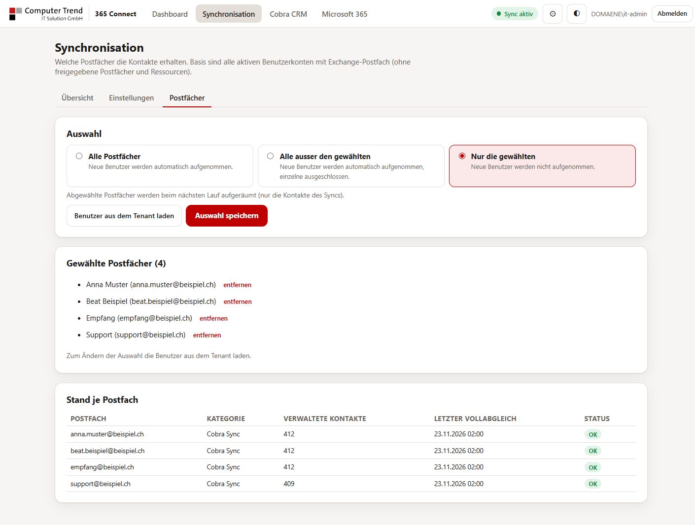
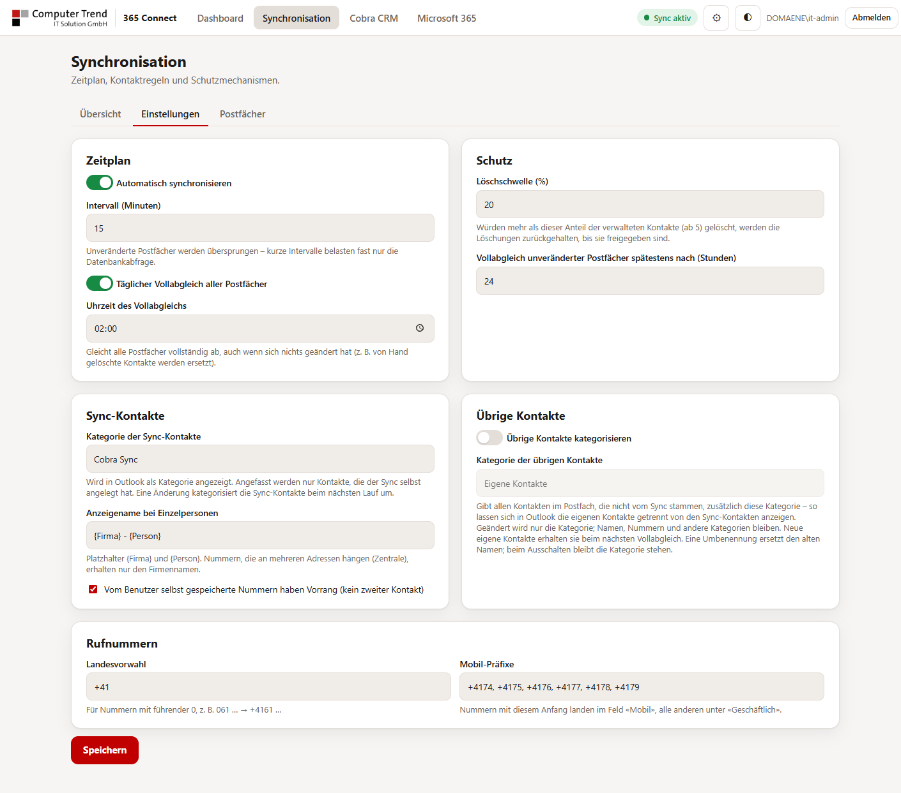
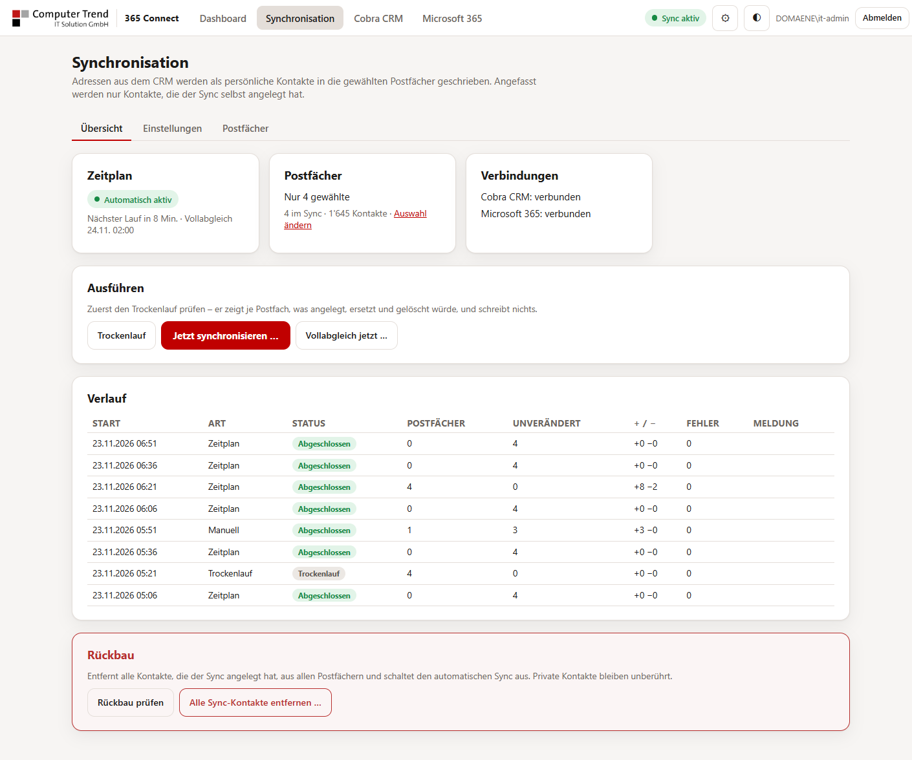

# Installation und Einrichtung

Diese Anleitung führt von einem leeren Server bis zur laufenden Anruferkennung. Rechne für eine Erstinstallation
mit etwa einer Stunde, inklusive Testanruf.

**Inhalt**

1. [Vorbereitung](#1-vorbereitung)
2. [Programm installieren](#2-programm-installieren)
3. [Einrichtung freischalten](#3-einrichtung-freischalten)
4. [Microsoft 365 verbinden](#4-microsoft-365-verbinden)
5. [Cobra CRM verbinden](#5-cobra-crm-verbinden)
6. [Postfächer und Einstellungen](#6-postfächer-und-einstellungen)
7. [Erster Lauf und Testanruf](#7-erster-lauf-und-testanruf)
8. [Automatischen Sync einschalten](#8-automatischen-sync-einschalten)
9. [Optional: Zugriff aus dem Netz und weitere Benutzer](#9-optional-zugriff-aus-dem-netz-und-weitere-benutzer)

---

## 1. Vorbereitung

| Was | Wofür |
|---|---|
| Windows Server 2019 oder neuer mit lokalem Administratorrecht | Installation als Windows-Dienst |
| Netzwerkzugriff vom Server auf den SQL-Server von Cobra (Standard TCP 1433) | Lesen der Adressen |
| Ausgehend HTTPS zu `login.microsoftonline.com`, `graph.microsoft.com` und GitHub | Microsoft 365 und Updates |
| Konto mit «Globaler Administrator» oder «Administrator für privilegierte Rollen» | einmalig für die App-Registrierung |
| `sa` oder ein Windows-Konto, das auf dem SQL-Server Logins anlegen darf | einmalig für das Cobra-Leselogin |
| Absprache mit dem Kunden | Die App erhält das Recht, persönliche Kontakte in den Postfächern des Tenants zu schreiben (siehe [Sicherheit](sicherheit.md#berechtigungen-in-microsoft-365)) |

> [!TIP]
> Die Einrichtung von Microsoft 365 und das erste Freischalten funktionieren nur **direkt auf dem Server**
> (z. B. per RDP), weil die Anmeldung bei Microsoft auf `localhost` zurückleitet. Alles Weitere geht später auch
> aus dem Netz, wenn der [Fernzugriff](betrieb.md#fernzugriff) eingeschaltet ist.

## 2. Programm installieren

1. Unter [Releases](https://github.com/c-trend/M365Connect-Public/releases) das neueste Paket `M365Connect-<Version>-win-x64.zip` herunterladen und die
   Datei `Install-M365Connect.ps1` daraus auf den Server kopieren.
2. PowerShell **als Administrator** öffnen und ausführen:

   ```powershell
   Set-ExecutionPolicy -Scope Process Bypass
   .\Install-M365Connect.ps1 -AdminMembers 'DOMÄNE\techniker'
   ```

   `-AdminMembers` nimmt ein oder mehrere Konten oder AD-Gruppen in die Admin-Gruppe auf
   (`'DOMÄNE\techniker','DOMÄNE\IT-Admins'`). Ohne Angabe erhält das ausführende Konto Zugang.

Das Skript erledigt dabei:

- neuestes Release laden und Prüfsumme sowie Signatur prüfen;
- .NET und ASP.NET Core Runtime 10 installieren, falls sie fehlen (abschaltbar mit `-NoRuntimeInstall`);
- Programm nach `C:\Program Files\CT M365 Connect` entpacken;
- lokale Gruppe **«CTM365Connect Admins»** anlegen und die Konten aufnehmen;
- Ereignisquelle «CT M365 Connect» und Dienst **«CTM365Connect»** (verzögerter Autostart) einrichten;
- Dienst starten, auf die Bereitschaft warten und den **Einrichtungs-Token** anzeigen.

Weitere Aufrufe des Skripts:

| Aufruf | Wirkung |
|---|---|
| `-Version 0.3.3` | eine bestimmte Version installieren |
| `-DownloadOnly C:\Temp\m365connect` | Paket nur laden und prüfen, ohne Installation |
| `-Uninstall` | Dienst und Programm entfernen, Daten behalten (`-RemoveData` löscht auch die Daten) |
| `-EnableRemoteAccess -RemoteNetworks 192.168.1.0/24` | Zugriff aus dem Netz einschalten (siehe [Betrieb](betrieb.md#fernzugriff)) |
| `-DisableRemoteAccess` | wieder nur lokal |

## 3. Einrichtung freischalten

1. Auf dem Server `https://localhost:8443/` öffnen. Die Zertifikatswarnung einmal bestätigen – das Programm erzeugt
   ein eigenes Zertifikat.
2. Die Anmeldung läuft automatisch über das Windows-Konto. Wer nicht in «CTM365Connect Admins» ist, wird abgewiesen.
3. Den Einrichtungs-Token aus dem Setup-Skript eingeben. Er ist 24 Stunden gültig und nur einmal verwendbar.
   Ging er verloren, steht er auf dem Server in `C:\ProgramData\CT M365 Connect\setup\setup-token.txt`.

> [!IMPORTANT]
> Eine neue Gruppenmitgliedschaft gilt aus dem Netz ab der nächsten Anmeldung an der Oberfläche. Direkt auf dem
> Server (z. B. per RDP) muss sich das Konto einmal von Windows ab- und wieder anmelden.

## 4. Microsoft 365 verbinden

Beide Verbindungen werden über das Zahnrad oben rechts eingerichtet: **Einstellungen (⚙) → Verbindungen** zeigt den
Stand der Module und führt zu den Assistenten.



**Einstellungen (⚙) → Verbindungen → Microsoft 365**:

1. **Tenant**: leer lassen, wenn das Admin-Konto zum Kundentenant gehört. Bei GDAP- oder Gastkonten den Tenant des
   Kunden eintragen, z. B. `kunde.onmicrosoft.com`.
2. **Anmeldung starten** → Link «Hier bei Microsoft anmelden» → mit dem Admin-Konto anmelden (MFA).
3. Namen der App belassen («CT M365 Connect - Sync») → **Anlegen …** → **Ja, anlegen**. Der Assistent
   - erzeugt ein Zertifikat (10 Jahre gültig) im Zertifikatsspeicher des Computers,
   - legt die App-Registrierung samt Dienstprinzipal an und
   - erteilt die Administratorzustimmung für `Contacts.ReadWrite` und `User.Read.All` (Anwendungsberechtigungen).
4. Ein bis zwei Minuten warten → **Verbindung testen** → «Verbunden. N Benutzerpostfächer gefunden».



## 5. Cobra CRM verbinden

**Einstellungen (⚙) → Verbindungen → Cobra CRM**. Der Assistent richtet in vier Schritten Verbindung und Leselogin ein:

1. **SQL-Server**: Name oder Adresse, bei Bedarf Port oder benannte Instanz (z. B. `SRV01\COBRA`).
2. **Anmeldung für die Einrichtung**: `sa` oder «Windows-Anmeldung mit anderem Konto» (DOMÄNE\benutzer und
   Passwort). Diese Anmeldung dient nur dazu, das Leselogin anzulegen, und wird nicht gespeichert.
   «Windows-Anmeldung des Dienstes» meldet sich als Computerkonto an, nicht als Techniker.
3. **Datenbank und Tabelle**: Cobra-Datenbank und Adresstabelle (in der Regel `dbo.ADDRESSES`) aus den Listen wählen.
4. **Leselogin**: Namen belassen (`m365connect_read`) → **Leselogin anlegen und prüfen**. Das Login erhält ein
   Zufallspasswort und nur Leserecht auf die gewählte Tabelle.

Danach **Weiter zu Feldzuordnung & Filter** bzw. **Cobra CRM → Feldzuordnung & Filter**:

1. **Feldzuordnung**: Firma, Vorname, Nachname, Telefonnummern und optional die Adresse. Mit
   **Beispielzeilen anzeigen** prüfen.
2. **Adressfilter**: z. B. nur Kunden, oder Privatadressen, Bewerber und Mitarbeitende ausschliessen. Die Anzahl
   Adressen wird laufend angezeigt.
3. **Vorschau**: Stichproben der entstehenden Kontakte prüfen → **Fertig**.



**Cobra CRM → Übersicht** zeigt anschliessend Verbindung, Auswahl und Zuordnung; **Vorschau erstellen** zeigt
jederzeit, welche Kontakte entstehen würden.



> [!NOTE]
> Bei einem Anmeldefehler versucht das Programm genau einmal und stoppt dann die automatischen Läufe, damit das
> SQL-Konto nicht gesperrt wird. Nach dem Korrigieren die Verbindung neu speichern.

## 6. Postfächer und Einstellungen

**Synchronisation → Postfächer**

- Für den Anfang **«Nur die gewählten»** → **Benutzer aus dem Tenant laden** → ein Testpostfach anhaken →
  **Auswahl speichern**.
- Später auf «Alle Postfächer» oder «Alle ausser den gewählten» umstellen. Neue Benutzer kommen dann automatisch dazu.



**Synchronisation → Einstellungen**

| Einstellung | Empfehlung |
|---|---|
| Automatisch synchronisieren | vorerst **aus** |
| Intervall | 15–60 Minuten; unveränderte Postfächer werden übersprungen |
| Täglicher Vollabgleich | ein, z. B. 02:00 |
| Kategorie | «Cobra Sync» – an ihr erkennt das Programm seine eigenen Kontakte |
| Anzeigename | `{Firma} - {Person}` |
| Landesvorwahl und Mobil-Präfixe | für die Schweiz `+41` und `+4174 … +4179` |
| Löschschwelle | 20 % |



## 7. Erster Lauf und Testanruf

1. **Synchronisation → Trockenlauf**: zeigt je Postfach, was angelegt, ersetzt und gelöscht würde – ohne zu schreiben.
2. **Jetzt synchronisieren …** → **Ja, ausführen**.
3. In Outlook beim Testbenutzer unter Kontakte prüfen: Die Kontakte tragen die Kategorie «Cobra Sync».
4. Von einer Nummer, die im CRM erfasst ist, **zweimal** auf die Teams-Nummer des Testbenutzers anrufen. Teams
   nutzt einen Zwischenspeicher – massgebend ist der zweite Anruf.



## 8. Automatischen Sync einschalten

Nach erfolgreichem Testanruf:

1. **Synchronisation → Postfächer**: Auswahl erweitern und speichern.
2. **Synchronisation → Einstellungen**: «Automatisch synchronisieren» einschalten und speichern.
3. Nach dem ersten automatischen Lauf das Dashboard prüfen.

Für die Überwachung durch ein RMM-Werkzeug siehe [Überwachung](ueberwachung.md).

## 9. Optional: Zugriff aus dem Netz und weitere Benutzer

- **Einstellungen → Fernzugriff**: Oberfläche aus freigegebenen privaten Netzen erreichbar machen (siehe [Betrieb](betrieb.md#fernzugriff)).
- **Einstellungen → Benutzer**: weitere Techniker in die Admin-Gruppe aufnehmen (siehe [Betrieb](betrieb.md#benutzer)).
